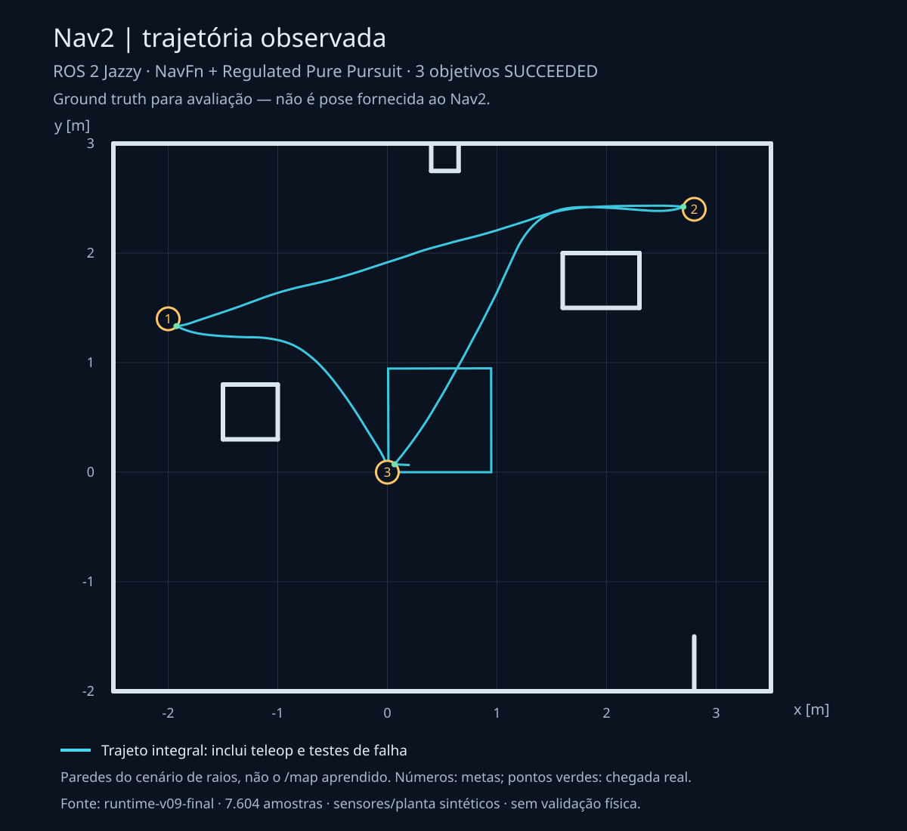
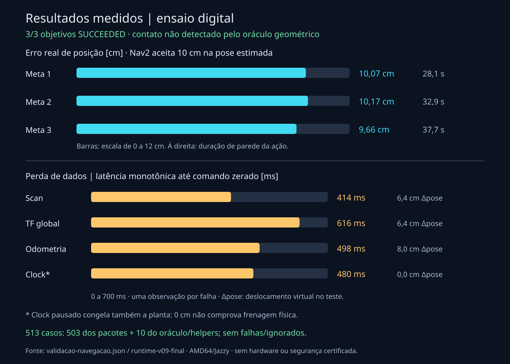

# Imagens do ensaio Nav2

Imagens próprias e publicáveis, geradas **dos dados observados em `runtime-v09-final`**, sem reproduzir modelos CAD ou suas malhas. A [captura RViz local](../previa-navegacao.png) contém derivados com licença pendente e não integra o Git público.

## Trajeto observado



[SVG editável](trajeto-nav2.svg). A linha ciano representa todas as 7.604 amostras de ground truth do fluxo: inclui o quadrado de condução manual para aprender o mapa, os objetivos autônomos e testes de cancelamento/falha. **Não é um percurso exclusivamente autônomo.** O quadrado central é a condução manual dos quatro lados, documentada em `ensaiar()` no [validador](../validar-navegacao.py), não um elemento geométrico inventado pelo gráfico.

As paredes são o cenário sintético do gerador de raios, **não o `/map` aprendido pelo SLAM**. Números indicam as três metas e pontos verdes a pose verdadeira observada após conclusão. O ground truth não alimenta a pose do Nav2; serve para avaliação independente. Eixos em metros, com escala uniforme.

## Objetivos e perdas de dados



[SVG editável](metricas-nav2.svg). Os três status `SUCCEEDED` vêm das respostas reais de `NavigateToPose`, não de uma inferência visual. O `SimpleGoalChecker` usa tolerância de 0,10 m e 0,15 rad **na pose estimada**. A pose verdadeira pode ter erro diferente; por isso 10,17 cm no oráculo não contradiz o sucesso observado pela estimativa.

Cada barra de perda de dados é **uma observação**, não média, pior caso certificado ou distribuição estatística. O tempo é medido por `time.monotonic()` entre suspender o produtor de dados e observar árbitro em `parado` com comando zerado. `Δpose` é a distância entre a pose virtual anterior à falha e a pose observada após confirmar parada, retomar o produtor e verificar recuperação. Não deve ser lida como distância física de frenagem nem como a distância percorrida exatamente durante a latência mostrada. Em perda de clock, a planta também congela.

Os 513 casos são 503 testes dos pacotes e 10 do oráculo/helpers; não representam 513 trajetórias ou ensaios físicos independentes. O [relatório executado](../validacao-navegacao.json) e os [resultados do fluxo](../evidencias/fluxo-resultado.json) registram critérios e limites. O oráculo auditou os segmentos entre poses com raio de 0,18 m e margem de amostragem de 0,005 m; não houve interseção detectada nesse cenário. Isso não certifica ausência de colisão no robô real.

## Reproduzir os gráficos

[Dados de entrada](dados-ensaio.json) incluem todas as coordenadas utilizadas, métricas e SHA-256 do trajeto bruto, do recibo e do mundo. Não há malhas, CAD, credenciais ou dados de conexão nesses arquivos.

```bash
python docs/navegacao/imagens/gerar-imagens.py
rsvg-convert docs/navegacao/imagens/trajeto-nav2.svg -o docs/navegacao/imagens/trajeto-nav2.png
rsvg-convert docs/navegacao/imagens/metricas-nav2.svg -o docs/navegacao/imagens/metricas-nav2.png
```

O gerador usa apenas a biblioteca padrão Python; a conversão PNG usa `rsvg-convert`. SVGs e PNGs foram renderizados e inspecionados visualmente. Esses gráficos não removem a dependência de recursos locais do pacote completo, não são ensaio físico e não estabelecem licença geral para o projeto.
